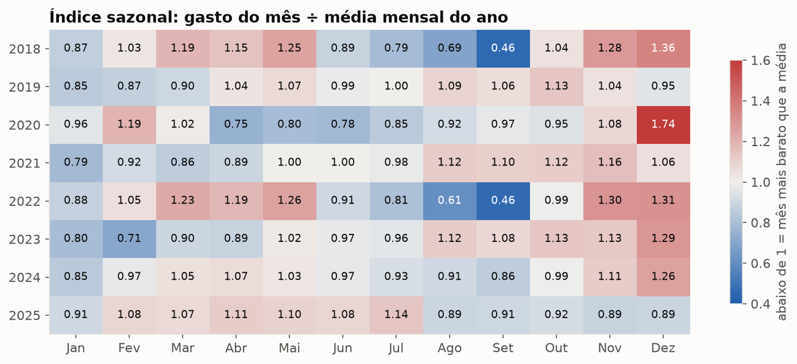
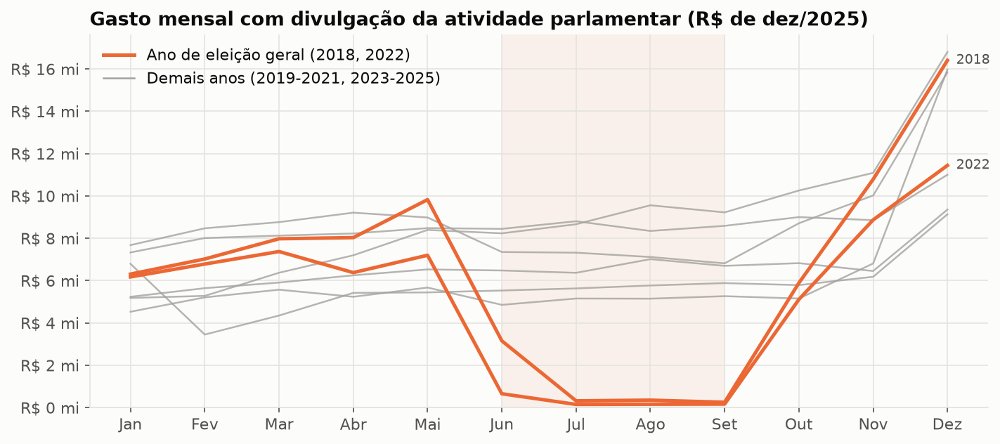
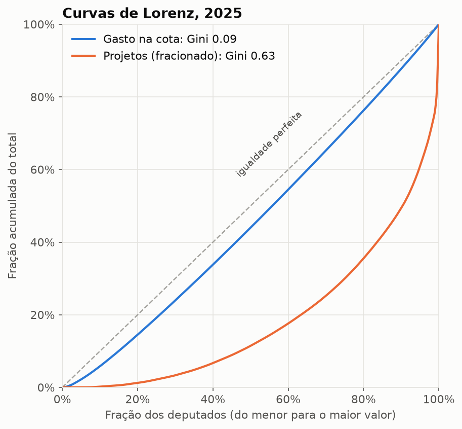
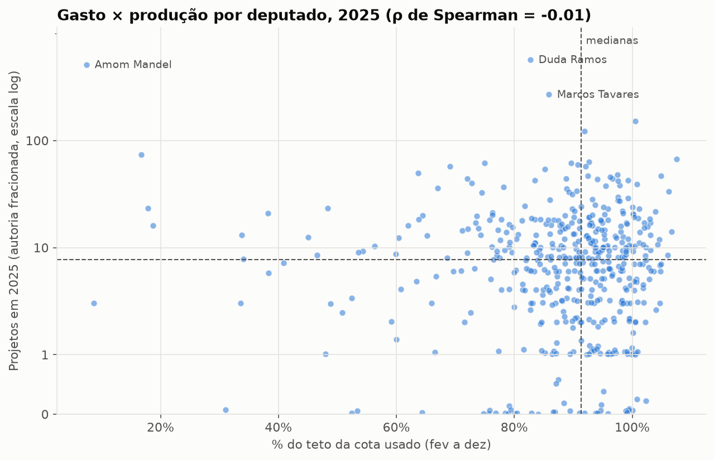

# Cota Parlamentar e produção legislativa na Câmara dos Deputados

Análise dos dados abertos da Câmara dos Deputados que cruza o uso da Cota para o Exercício da Atividade Parlamentar (CEAP) com a produção legislativa de cada deputado. A série vai de 2018 a 2025, a produção é medida em 2025, e a análise usa índice de Gini, curvas de Lorenz, regressão com efeitos fixos e testes não paramétricos.

## Contexto: desafio técnico e feedback

Este repositório começou como um desafio técnico de um processo seletivo, em julho de 2026. A entrega original é o notebook [`analise_camara.ipynb`](analise_camara.ipynb). Não passei para a etapa seguinte, pedi um retorno à empresa e recebi esta avaliação:

> - A análise estatística ficou um pouco superficial para o perfil da vaga, recomendamos aprofundar mais as investigações e usar séries históricas mais longas (o gráfico de gastos mensais, por exemplo, precisaria contemplar múltiplos anos para sustentar conclusões sobre sazonalidade).
> - O tratamento de erros no código apresentou fragilidades (ex: uso de "except ... break" sem tratamento adequado da exceção).
> - Vale explorar técnicas estatísticas mais avançadas para esse tipo de dado, como por exemplo Índice de Gini ou Curva de Lorenz, que outros candidatos aplicaram com bons resultados.

O notebook [`analise_camara_v2.ipynb`](analise_camara_v2.ipynb) refaz a análise a partir desse retorno. A versão original continua no repositório, sem alterações no código, como registro do que foi avaliado.

## O que mudou

| Crítica | Resposta na v2 |
|---|---|
| Série curta para falar de sazonalidade | Série mensal de 2018 a 2025 (96 meses), corrigida pelo IPCA. Índice sazonal por ano, teste de Friedman e regressão com efeitos fixos de ano e mês, separando o padrão sazonal do efeito das eleições e da pandemia. Verificação fora da amostra com os dados parciais de 2026. |
| `except ... break` | Exceção própria (`ExtracaoIncompletaError`), novas tentativas com espera crescente, retomada de downloads interrompidos com `Range`, checagem de integridade do cache e falhas registradas em vez de engolidas. Um teste com uma API simulada mostra a diferença: a v1 devolve 100 de 250 despesas sem avisar, e a v2 registra a falha. |
| Gini e Lorenz | Gini com intervalo de confiança por bootstrap para gasto e produção, curvas de Lorenz, Gini do gasto ano a ano (2018 a 2025), decomposição de Theil por estado e concentração de fornecedores por categoria. |
| Análise superficial | Histórico oficial de exercício do mandato (API) para definir quem conta, teste do efeito "use ou perca" em dezembro, correlação de Spearman com intervalo de confiança e teste de permutação, quadrantes pela mediana e decomposição que mostra por que "custo por projeto" engana. |

Outros problemas da v1 corrigidos na revisão:

- **Coautoria contada em dobro.** Cada coautor ganhava um projeto inteiro. As PECs de 2025 tiveram mediana de 172 autores, e no total os deputados apareciam com 12.705 "projetos" para 7.082 proposições. Agora cada proposição vale 1, dividido entre seus autores.
- **Eleição em 2025.** A v1 atribuía o pico de dezembro ao "período eleitoral", mas não houve eleição em 2025. E, pelo mês da cota, dezembro de 2025 nem foi pico.
- **Quadrantes pela média.** A média é puxada por poucos deputados muito produtivos, o que inflava a "ineficiência crítica". Agora o corte é pela mediana.
- **Valor do documento × valor reembolsado.** A v1 somava `valorDocumento`. Agora uso `vlrLiquido`, que desconta as glosas.
- **Quem estava no cargo.** A v1 usava só os deputados em exercício na data da extração e comparava suplentes de poucos meses com titulares do ano todo. Agora os dias em exercício vêm do histórico oficial de cada deputado.
- **MPV e PLV na produção.** São do Executivo. Ficam só PL, PLP, PEC e PDL.

## Principais resultados

**1. A sazonalidade existe, mas não é a que a v1 descreveu.** Janeiro ficou abaixo da média do ano em todos os 8 anos, cerca de 19% abaixo do mês médio. Novembro e dezembro ficaram de 11% a 14% acima. Dezembro ficou acima da média em 6 de 8 anos, e 2025, o ano analisado na v1, foi uma das exceções.



**2. O maior efeito do calendário é eleitoral.** De junho a setembro de anos de eleição geral, o gasto cai 41% (IC 95%: 34% a 48%). O motivo é a proibição de pagar divulgação com a cota nos 120 dias antes da eleição (Ato da Mesa nº 43/2009, art. 2º, XII). Os dados parciais de 2026 repetem o padrão.



**3. Dezembro tem um componente "use ou perca".** O saldo da cota não passa para o ano seguinte (art. 13). Quem chega a dezembro com mais saldo gasta mais em dezembro (ρ = 0,41 em 2024 e 0,21 em 2025), e o excesso de dezembro é quase todo divulgação.

**4. O gasto é quase igual entre deputados, e a produção não.** O Gini do gasto é 0,09, porque o deputado mediano usa 91% do teto. O Gini da produção é 0,63, e 10% dos deputados respondem por metade dos projetos.



**5. Gasto e produção não têm relação mensurável.** ρ de Spearman = −0,04 (IC 95%: −0,13 a 0,05). Por isso "custo por projeto" não mede eficiência: 96% da variação dele vem do número de projetos.



**6. Para a fiscalização, a maior categoria é a mais pulverizada.** Divulgação soma R$ 102 milhões espalhados por 3.139 fornecedores, e os 10 maiores ficam com 8%. Locação de veículos e combustíveis são bem mais concentradas.

**7. Em valores reais, a cota encolheu.** O gasto total caiu 23% entre 2018 e 2025, descontada a inflação.

As limitações (a cota é só parte do custo de um deputado, contar proposições não mede qualidade e a análise é observacional) estão na Seção 8 do notebook.

## Como rodar

```bash
pip install -r requirements.txt
jupyter notebook analise_camara_v2.ipynb
```

Depois é só executar todas as células (**Run All**). A primeira execução baixa cerca de 200 MB de arquivos oficiais e consulta o histórico de cerca de 1.200 deputados na API, o que leva de 2 a 3 minutos. Tudo fica em cache em `Dados/brutos/` (ignorado pelo git), e as execuções seguintes levam cerca de 30 segundos. Testado com Python 3.14, pandas 3.1, NumPy 2.5, SciPy 1.18, statsmodels 0.15 e Matplotlib 3.11.

## Estrutura

```
.
├── analise_camara_v2.ipynb   # versão revisada após o feedback
├── analise_camara.ipynb      # entrega original do desafio (julho de 2026)
├── figuras/                  # gráficos gerados pela v2 e usados neste README
├── requirements.txt
└── Dados/                    # cache local, gerado na primeira execução (ignorado pelo git)
```

## Fontes

- Câmara dos Deputados, dados da CEAP por ano: `https://www.camara.leg.br/cotas/Ano-AAAA.csv.zip`
- Câmara dos Deputados, arquivos de proposições e autores e API v2 (histórico de exercício): https://dadosabertos.camara.leg.br/swagger/api.html
- Banco Central, SGS série 433 (IPCA mensal): https://api.bcb.gov.br/dados/serie/bcdata.sgs.433/dados?formato=json
- Ato da Mesa nº 43/2009, texto atualizado com as regras e os valores da cota: https://www2.camara.leg.br/legin/int/atomes/2009/atodamesa-43-21-maio-2009-588364-normaatualizada-cd-mesa.html

## Tecnologias

Python, pandas, NumPy, SciPy, statsmodels, Matplotlib, requests
